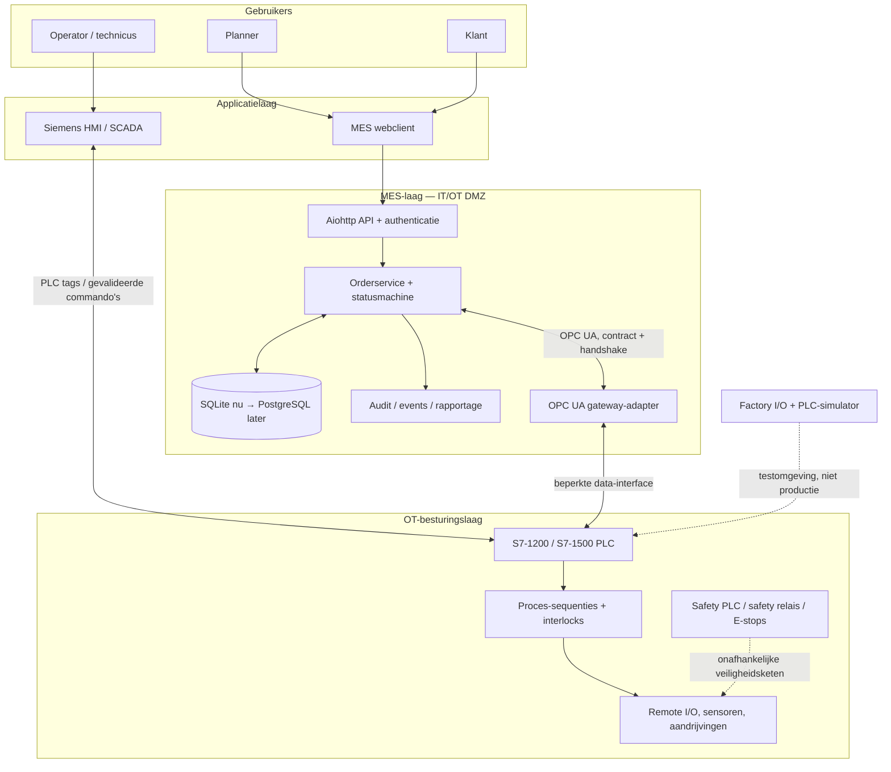

# Warehouse HMI Interface — doelarchitectuur v2

**Status:** architectuurvoorstel / technische review  
**Repository:** `kali-linux2008/Warehouse_HMI_Interface`  
**Basis:** huidige `main`-branch; deze branch voegt documentatie toe en wijzigt geen PLC- of MES-runtimecode.

## 1. Doel en ontwerpprincipes

Het project groeit van een magazijnsimulatie naar een modulair warehouse-control-systeem met Siemens PLC, Factory I/O, HMI/SCADA en een MES/WMS-bridge.

Ontwerpprincipes:

1. **PLC = realtime procesbesturing.** Interlocks, sequenties, sensoren, actuatoren, time-outs en veilige stopreacties blijven in de PLC en onafhankelijke veiligheidscomponenten.
2. **MES = order- en materiaalstroom.** Orders, prioriteiten, klanten, planning, traceability en rapportage horen niet in de HMI.
3. **HMI = bediening en observatie.** De HMI toont PLC-status en vraagt acties aan; de PLC valideert iedere actie opnieuw.
4. **Een expliciet contract tussen lagen.** OPC UA-tags, datatypes, enumwaarden, units, schrijfrechten, handshake en time-outs worden versiebeheerd.
5. **Offline gedrag is voorspelbaar.** Bij netwerk- of MES-uitval stopt de PLC niet abrupt midden in een onveilige beweging; nieuwe opdrachten worden geblokkeerd of gebufferd volgens een vooraf bepaalde bedrijfsstrategie.
6. **Simulatie en productie delen logica, niet blind dezelfde aannames.** Simulatieblokken zijn verwisselbare implementaties achter dezelfde procesinterface.
7. **Geen veiligheidsclaim op basis van standaard PLC-code.** Een echte installatie vereist een risicoanalyse, geschikte safety-PLC/relais, gecertificeerde componenten en validatie volgens de toepasselijke normen.

## 2. Huidige situatie — wat al aanwezig is

- TIA Portal V20-project met SCL-types, magazijn-DB, order-DB, cyclische functies en kraansimulatie.
- Vier stellingen met 54 vakken per stelling: 216 opslaglocaties, verdeeld over twee gangen.
- Productcodes 1, 2, 11 en 12; vakweergave 0/1/2/3/4/9.
- MES-bridge in Python/aiohttp met SQLite, browserclient, rollen klant/planner/beheerder, sessies, auditlog en OPC UA-client.
- PLC-orderbuffer van 20 orders en een handshake voor nieuwe orders en annuleringen.
- OPC UA-levenstekens tussen MES en PLC.
- PLC-simulator voor het testen van de MES-bridge zonder fysieke PLC.
- Afzonderlijke Factory I/O-kraan-FB als begin voor een echte gesimuleerde sequentie.
- HMI-ontwerp met F1–F6-schermen en een aparte klant-/plannerbestelapp.

## 3. Doelarchitectuur



### Vertrouwensgrenzen en netwerk

- **Enterprise/gebruikersnetwerk:** browserclient en planner/klanttoegang.
- **IT/OT-DMZ:** reverse proxy/API, identity, audit en OPC UA-gateway. Alleen noodzakelijke verbindingen door de firewall.
- **OT-cel:** PLC, HMI, remote I/O en aandrijvingen. Geen directe internettoegang.
- **Safety-keten:** E-stop, deuren, lichtschermen en veilige aandrijfuitschakeling via geschikte safetyhardware; niet afhankelijk van Python, SQLite, browser of gewone OPC UA-berichten.

Sta alleen expliciete bron-/doelcombinaties en poorten toe. Beheerinterfaces en programmeerpoorten zijn niet bereikbaar vanuit het klantnetwerk.

## 4. Verantwoordelijkheden per component

| Component | Verantwoordelijkheid | Niet verantwoordelijk voor |
|---|---|---|
| PLC | Interlocks, machine-state, kraanbeweging, sensorvalidatie, watchdogs, lokale buffers | Klantaccounts, websessies, rapportage |
| Siemens HMI | Live status, alarmen, operatorcommando's, diagnose | Orderdatabase of safety-certificering |
| MES API | Login, rollen, validatie, orderinvoer, API-contract | Directe motor-/cilinderbesturing |
| Orderservice | Prioriteit, toewijzing, orderstatus, herstel na uitval | Realtime beweging |
| Database | Orders, gebruikers, events, audit en configuratie | PLC-scanbesturing |
| OPC UA-adapter | Datacontract, reconnect, heartbeat, command/ack, mapping | Zelfstandig besluiten dat een machine veilig kan bewegen |
| Factory I/O | Virtuele sensoren/actuatoren en scenario's | Productieve veiligheidsfunctie |

## 5. Belangrijkste technische bevindingen en risico's

Dit zijn code-reviewbevindingen op de bekeken bestanden; ze zijn geen bewijs van een complete validatie van het hele project.

### P0 — oplossen vóór een echte machine of onbemande test

**A. Annuleringstatus kan terugvallen naar 'in_plc'.**  
In `mes-bridge/plc.py` bevat `PLC_STATUS` de codes 1 t/m 5 niet volledig: PLC-code 5 (geannuleerd) ontbreekt. Daarnaast kan `synchroniseer()` na een succesvolle annulering de DB-status `geannuleerd` door een volgende PLC-read weer overschrijven, omdat `update_vanuit_plc()` die terminale status niet beschermt.  
**Aanpak:** voeg een expliciete mapping voor 5 toe en definieer terminale statussen (`gereed`, `geannuleerd`, `geweigerd`) als niet-terugschrijfbaar, behalve via een expliciete correctie-/reconciliatieprocedure. Test de volledige annulering inclusief meerdere synchronisatierondes.

**B. MES kan opdrachten opnieuw proberen zonder formele command-identiteit.**  
De huidige handshake gebruikt een `Nieuw`-bit en ordernummer. Dat helpt bij reconnects, maar een robuuste interface moet elke opdracht uniek identificeren en een ondubbelzinnige ACK/NAK bewaren.  
**Aanpak:** gebruik `CommandId` (monotone teller of UUID-string), `AckCommandId`, `ResultCode`, `PayloadVersion` en een command-state. PLC verwerkt een CommandId maximaal één keer; MES herhaalt veilig dezelfde ID tot ACK of timeout. Maak ook de annulering idempotent.

**C. Standaard PLC-code is geen machineveiligheid.**  
De kraan-FB heeft een software-watchdog en limietsignalen, maar dat vervangt geen safety-ontwerp. Een softwarefout, communicatieverlies of gewone PLC-stop mag niet de enige bescherming tegen beknelling of botsing zijn.  
**Aanpak:** voer een risicoanalyse uit en ontwerp onafhankelijke E-stop-, deur-/toegangs- en veilige aandrijfketens met geschikte safetyhardware. Valideer veilige toestand, remgedrag en herstartprocedure met een bevoegde machineveiligheidsdeskundige.

### P1 — oplossen vóór pilotbedrijf

**D. OPC UA-beveiliging moet expliciet worden afgedwongen.**  
De huidige client maakt een standaard `asyncua.Client` aan en configureert optioneel gebruikersnaam/wachtwoord, maar de getoonde code configureert geen certificaatvertrouwen of versleutelde OPC UA-policy.  
**Aanpak:** gebruik certificaten, trustlists, SignAndEncrypt, unieke service-identiteiten, beperkte OPC UA-nodes/rechten, rotatie en logging. Schakel anonieme toegang uit op de PLC. Beperk poort 4840 tot de gateway en PLC in het OT-netwerk.

**E. API-sleutels hebben een vaste planner-rol.**  
In `auth_mw` wordt een geldige Bearer API-key als planner geautoriseerd. Daardoor is de autorisatie grover dan een per-client scope.  
**Aanpak:** koppel API-sleutels aan service-identiteit, scopes en toegestane endpoints; maak aparte lees- en schrijfsleutels; roteer en trek sleutels in; log sleutel-ID, nooit het geheim.

**F. Reverse-proxy/TLS-afhandeling moet bewust worden ingericht.**  
De cookie `Secure` en HSTS hangen af van `request.secure`. Bij TLS-terminatie op een reverse proxy kan de backend het verzoek als HTTP zien. Vertrouw forwarded headers uitsluitend van een bekende proxy.  
**Aanpak:** leg één TLS-terminatiepatroon vast, configureer proxy-trust expliciet en test Secure/HttpOnly/SameSite-cookies, Origin/CSRF, HSTS en redirects vanaf de browser.

**G. Ordertoewijzing en voorraadreservering zijn nog niet één transactie.**  
De code reserveert geen specifiek vak voor een order en de kraansimulatie kiest het oudste vak van een productsoort. Bij meerdere orders, annuleringen of een echte kraan is een expliciete picklijst nodig.  
**Aanpak:** MES maakt pickregels met locatie, product, hoeveelheid en prioriteit; PLC accepteert een pickopdracht en reserveert die locatie atomair; voorraadmutaties worden pas bevestigd na sensorbevestiging.

**H. HMI/MES-commando's moeten dezelfde PLC-interlocks gebruiken.**  
`FB_Mes` start orders automatisch per gang, terwijl HMI-commando's ook rechtstreeks een orderstatus kunnen wijzigen. Dit kan de aanname van maximaal één actieve order per gang doorbreken.  
**Aanpak:** één PLC-arbiter beheert alle start/pauze/annuleer-verzoeken. Valideer gangbezetting, machine-mode, storingen, reservering en orderstatus op één plek. HMI schrijft alleen verzoeken; nooit de autoritatieve status.

### P2 — schaalbaarheid en onderhoud

- SQLite is prima voor een lokale demonstrator. Voor meerdere services, historiek, rapportage en herstel is PostgreSQL een logische volgende stap.
- Voeg database-migraties, back-up/restore-tests en retentiebeleid toe.
- Voeg gestructureerde logs, metrics en health/readiness endpoints toe; onderscheid PLC-online, heartbeat-stale, OPC UA-connected en machine-ready.
- Maak order-, product-, vak- en alarmcodes centrale enums/schemas en genereer documentatie/tests uit het contract.
- Voeg CI toe voor Python-linting, typechecks, unit-/integratietests en SCL-reviewchecklists.
- Gebruik configuratie via environment/secrets manager; geen wachtwoorden of API-sleutels in repository of logs.

## 6. Datamodel en orderlevenscyclus

Gebruik een expliciete statusmachine met toegestane overgangen:

```text
NEW → VALIDATED → QUEUED → DISPATCHED → ACCEPTED → RUNNING
                                           ↘ REJECTED
RUNNING → PAUSED → RUNNING
RUNNING → COMPLETED
QUEUED / ACCEPTED / RUNNING → CANCEL_REQUESTED → CANCELLED
Elke status → FAULTED (alleen met foutreden en herstelprocedure)
```

Aanbevolen entiteiten:

- `Order`: id, ordernummer, klant, product, hoeveelheid, prioriteit, dock, status, created_at, updated_at, versie.
- `OrderLine`: product, hoeveelheid, toegewezen hoeveelheid, gepickt aantal.
- `PickTask`: order_id, locatie_id, product, status, kraan/gang, command_id.
- `Location`: stelling, gang, X/Y, product, bezet, gereserveerd, volgnummer, kwaliteit/status.
- `MachineEvent`: command_id, event_id, PLC-tijd, server-ontvangsttijd, type, resultaat.
- `AuditEvent`: actor, actie, object, resultaat, tijd, bron.

Maak onderscheid tussen **orderstatus**, **commandostatus**, **machine-/kraanstatus** en **voorraadstatus**. Eén veld mag niet al deze betekenissen dragen.

## 7. PLC-architectuur

Verdeel de PLC-code in duidelijke lagen:

1. **IO-map:** fysieke I/O, schaalconversie, diagnose en kwaliteitsbits.
2. **Safety interface:** alleen statusinformatie uit safetyhardware; gewone PLC-code omzeilt die functies nooit.
3. **Machine state machine:** OFF, INIT, READY, AUTO, MANUAL, STOPPING, FAULT.
4. **Gang-/kraan-FB:** één instance per kraan met eigen commando, status, foutcode en watchdog.
5. **Warehouse manager:** locatiebeheer, bezetting, reserveringen en productidentiteit.
6. **MES interface:** command mailbox, ACK/NAK, heartbeat en data snapshots.
7. **HMI interface:** verzoekbits/command-ID's en read-only processtatus.

Gebruik één cyclische hoofdstructuur met voorspelbare aanroepvolgorde. Vermijd dat meerdere FB's dezelfde autoritatieve orderstatus rechtstreeks wijzigen. Maak handmatige bewegingen alleen mogelijk in een daarvoor ontworpen, beveiligde modus met hold-to-run waar de risicoanalyse dat vereist.

## 8. OPC UA-contract v2

Maak een versiebeheerbare interface, bijvoorbeeld namespace `urn:warehouse:mes:2`.

**MES → PLC**
- `CommandId`
- `PayloadVersion`
- `CommandType` (CreateOrder, CancelOrder, CreatePickTask, ResetRequest)
- order-/pickpayload
- `CommandValid` of queue entry state

**PLC → MES**
- `AckCommandId`
- `CommandResult` (Accepted, Rejected, Duplicate, Busy, Invalid)
- `RejectReason`
- order-/pickstatus snapshot
- machine mode, gangstatus, alarmcode
- PLC heartbeat en timestamp/quality

Regels:
- Schrijf payload eerst, commit/valid-bit als laatste.
- PLC kopieert payload naar interne buffer en valideert volledig voordat ACK wordt gezet.
- CommandId is idempotent; duplicate ID geeft dezelfde eerdere uitkomst terug.
- MES bewaart outbox/inflight-commando's duurzaam en herstelt na restart.
- Statusupdates hebben een versie/sequence zodat oude snapshots geen nieuwere status overschrijven.
- Definieer watchdog, reconnect backoff, stale-data gedrag en maximale queuegrootte.

## 9. Teststrategie en acceptatiecriteria

| Niveau | Test | Acceptatie |
|---|---|---|
| Unit | Statusmachine, ordervalidatie, product-/locatiemapping | Alle geldige en ongeldige overgangen getest |
| Integratie | API → DB → OPC UA-simulator → PLC-status | Order één keer geaccepteerd en correct afgerond |
| Herstel | MES herstart tijdens dispatch / PLC offline | Geen verloren of dubbel uitgevoerde opdracht |
| Annulering | Annuleren in elke status | Terminale status blijft correct na herhaalde polls |
| Concurrency | Twee orders zelfde gang/product | Geen dubbele kraantoewijzing of verkeerde pick |
| Security | Rollen, CSRF, API-scopes, rate limits, certificaten | Negatieve tests blokkeren ongeautoriseerde acties |
| Machine | Sensorstoring, timeout, limiet ontbreekt, communicatie weg | Voorspelbare foutreactie en gecontroleerd herstel |
| Safety | E-stop, deur open, veilige stop, reset | Gevalideerd volgens risicoanalyse en safetyplan |

Voor de huidige simulator: voeg regressietests toe voor annulering, duplicate CommandId, volle PLC-buffer, reconnect tijdens handshake, twee orders per gang, lege voorraad en foutvak.

## 10. Migratieroadmap

### Fase 1 — betrouwbaarheid (eerst)
- Annuleringsstatusbug repareren en regressietests toevoegen.
- Centrale status-enums en toegestane statusovergangen invoeren.
- PLC-command/ACK uitbreiden met CommandId en versie.
- HMI- en MES-commando's door één PLC-arbiter laten lopen.

### Fase 2 — contract en beveiliging
- OPC UA NodeSet/tagcontract documenteren en versiebeheer invoeren.
- Certificaatgebaseerde SignAndEncrypt configureren.
- API-key scopes en proxy/TLS-configuratie aanscherpen.
- Rollenmatrix en audit-events per commando afronden.

### Fase 3 — simulatie en proceslogica
- Eén gedeelde interface voor kraansimulatie en Factory I/O-kraan.
- PickTask/locatiereservering implementeren.
- Factory I/O-sensoren en actuatoren end-to-end testen.
- Storingsinjectie en hersteltests automatiseren.

### Fase 4 — pilotgereed
- PostgreSQL, migraties, back-ups en observability.
- OT-netwerksegmentatie en firewallregels.
- FAT/SAT-testplan en risicoanalyse.
- Safetyhardware en validatie vóór fysieke ingebruikname.

## 11. Besluit

De bestaande repository bevat al een bruikbare demonstratorbasis: een PLC-datamodel, MES-bridge, browserapp, OPC UA-simulator en een start van Factory I/O-kraanbesturing. De grootste stap naar een betrouwbaar industrieel systeem is niet een grotere HMI, maar het formaliseren van **statusbeheer, idempotente commando's, voorraadreservering, OPC UA-beveiliging en machineveiligheid**.

**Aanbevolen eerstvolgende codewijziging:** herstel de annulering/statussynchronisatie en bouw daarvoor regressietests. Daarna pas de OPC UA-command mailbox uitbreiden. Gebruik de echte machine pas na afzonderlijke risicoanalyse en safetyvalidatie.
